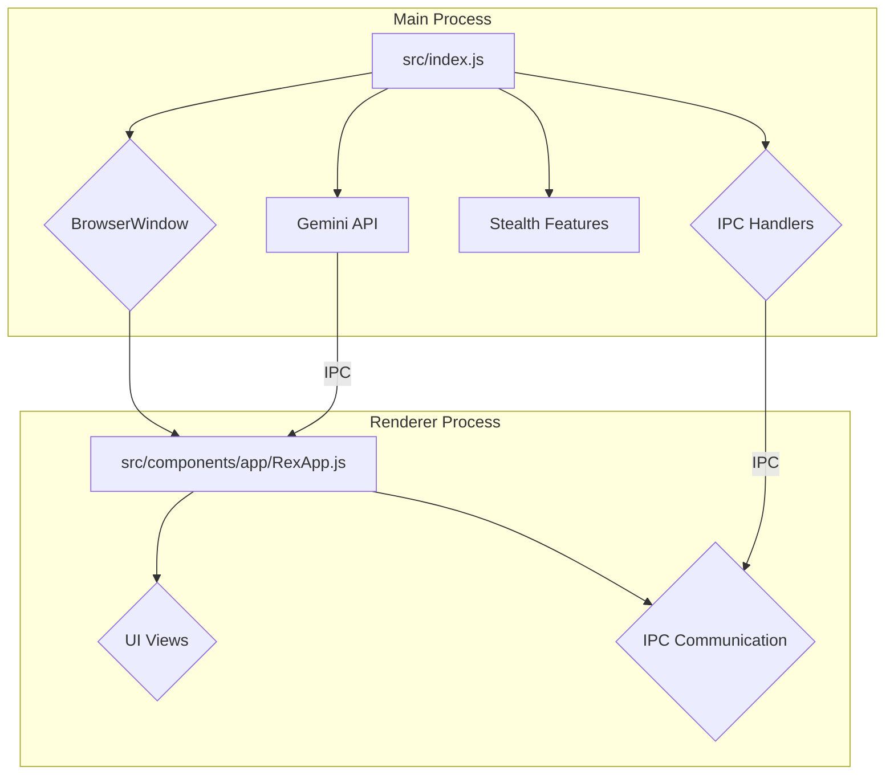

# TeaRex Application Architecture

TeaRex is a real-time AI assistant designed for interviews and learning. It captures screen and audio, sending them to the Gemini API for contextual responses. The application is built with Electron, allowing it to run as a cross-platform desktop application. It features a Lit-based frontend, configurable privacy controls, and a modular structure that separates concerns between the main and renderer processes.

## 2. Core Technologies

- **Electron:** The core framework for building the cross-platform desktop application.
- **Electron Forge:** Used for packaging and distributing the application.
- **Lit:** A lightweight library for building fast, lightweight web components, used for the application's UI.
- **Google Gemini:** The AI model used for generating responses.
- **Vite:** A fast build tool used for testing.

## 3. Architectural Diagram

## 4. Main Process (`src/index.js`)

The main process is the application's entry point and is responsible for managing the application's lifecycle, creating windows, and handling native OS interactions.

- **Window Management:** Creates and manages the main `BrowserWindow`, which loads the application's UI.
- **IPC Handlers:** Sets up IPC (Inter-Process Communication) handlers to communicate with the renderer process. This includes handling requests for configuration, file operations, and other native functionalities.
- **Stealth Features:** Implements anti-analysis measures to prevent detection, such as randomizing process names and applying other stealth techniques.
- **Gemini API Integration:** Manages the communication with the Gemini API, including sending audio and screen captures for analysis.

## 5. Renderer Process (`src/components/app/tearex.js`)

The renderer process is responsible for the application's user interface and user interactions.

- **UI Components:** The main application component, `RexApp.js`, is built with Lit and manages the different views of the application (e.g., main, customize, help).
- **State Management:** Manages the application's state, including the current view, user settings, and responses from the Gemini API.
- **IPC Communication:** Communicates with the main process via IPC to request native functionalities, such as accessing the file system or managing windows.

## 6. Inter-Process Communication (IPC)

IPC is used for communication between the main and renderer processes.

- **`ipcMain`:** Used in the main process to handle asynchronous and synchronous messages sent from the renderer process.
- **`ipcRenderer`:** Used in the renderer process to send messages to the main process.
- **`preload.js`:** A script that runs before the renderer process is loaded, used to expose a limited set of Node.js APIs to the renderer process in a secure way.

## 7. Stealth and Anti-Analysis Features

The application includes several features to avoid detection:

- **Process Randomization:** Randomizes process names to make it harder to identify the application.
- **Anti-Analysis Measures:** Implements various techniques to detect and prevent analysis by security tools.
- **Content Protection:** Prevents the application's window from being captured by screen recording software.

## 8. User Interface (UI)

The UI is built with Lit and is composed of several views:

- **Onboarding View:** Guides the user through the initial setup process.
- **Main View:** The main interface of the application, where the user can start a session.
- **Customize View:** Allows the user to customize the application's settings.
- **Help View:** Provides help and support information.
- **Assistant View:** Displays the responses from the Gemini API.

## 9. Build and Packaging

The application is packaged and distributed using Electron Forge.

- **`forge.config.js`:** The configuration file for Electron Forge, which specifies the build and packaging settings.
- **Makers:** The application is configured to be built for Windows, macOS, and Linux using different makers (e.g., Squirrel.Windows, DMG, AppImage).
- **Plugins:** Uses plugins to enhance the build process, such as auto-unpacking native modules.